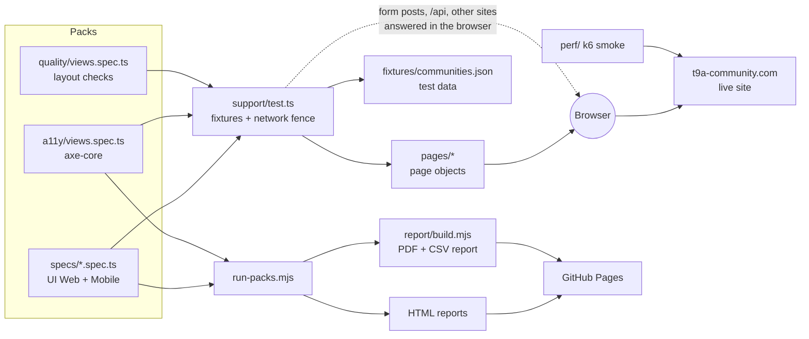

# World of Ninth Age: test suite

[](https://github.com/AdamRzymowski/WorldOfNinthAge-Test-suite/actions/workflows/checks.yml)
[](https://github.com/AdamRzymowski/WorldOfNinthAge-Test-suite/actions/workflows/tests.yml)
[](https://adamrzymowski.github.io/WorldOfNinthAge-Test-suite/)


[](LICENSE)

End-to-end, accessibility and performance tests for **[t9a-community.com](https://t9a-community.com)**,
an interactive world map that helps players of the tabletop game *The Ninth Age* find local communities,
stores and events. The site is a static Netlify site with serverless functions and forms; its code lives in
a separate private repository. This repository holds only the tests, and tests what the live site serves.

**Latest test report:** https://adamrzymowski.github.io/WorldOfNinthAge-Test-suite/ ·
**Project board:** https://github.com/users/AdamRzymowski/projects/1

## What this project shows

| Area | How |
|---|---|
| **End-to-end UI testing** | 279 Playwright tests in TypeScript over 21 spec files, page objects, custom fixtures, fixed clock and test data |
| **Cross-browser and mobile** | Chrome, Edge and Firefox, each on a desktop and a phone (Pixel 7): 1,674 test runs in a full pass |
| **Accessibility** | axe-core against WCAG 2.0/2.1/2.2 A and AA on 29 views, desktop and phone, with the broken rules grouped in the report |
| **Safe testing in production** | A network fence answers every form post, API call and third-party request inside the browser, so the live site is tested without side effects |
| **Performance** | k6 smoke run of the live site (1 visitor, 30 s); load, spike and soak profiles for a local copy |
| **Test management** | 255 manual test cases generated as a PDF, each matched to its automated test; a PDF/CSV run report compared with the previous run |
| **CI/CD** | GitHub Actions: type-check and lint on every push; test runs started by hand, reports published to GitHub Pages |
| **AI-assisted QA** | Claude Code agents that review the tests sceptically, verify claims on the live site, check UI quality and scan for security and legal issues |
| **QA documentation** | [Test strategy](docs/test-strategy.md), [test plan](docs/test-plan.md), [traceability matrix](docs/traceability.md), [bug report examples](docs/bug-reports/) |

## Architecture



## AI test agents (Claude Code)

| Agent | What it does |
|---|---|
| [Playwright Sceptic](.claude/agents/playwright-sceptic.md) | Reviews each test: would it fail if the behaviour its title names were broken? Finds tests that can't fail, over-mocked or flaky tests, and broken test rules |
| [Sanity Checker](.claude/agents/sanity-checker.md) | Checks claims about the live site the way a user would, in a real browser, and logs them in [docs/sanity-checks.md](docs/sanity-checks.md) |
| [Quality Checker](.claude/agents/quality-checker.md) | Measures each view in several languages and widths for text that doesn't fit, overlaps, sideways scrolling, broken images and small tap targets, then files defects in [docs/known-issues/](docs/known-issues/README.md) |
| [Security & legal sceptic](.claude/agents/sceptic-agent-security-legal-scan.md) | Scans this public repository for personal data, secrets, gaps in the network fence, risky CI and licence problems |

They read and report; none of them changes tests or code. Each is started by its skill in `.claude/skills/`.

## What's here

| Folder | What |
|---|---|
| `tests/specs/` | Playwright end-to-end tests of the site (UI Web and Mobile packs) |
| `tests/a11y/` | Accessibility tests: axe-core against WCAG 2.2 AA |
| `tests/quality/` | The Quality Checker's measuring run |
| `tests/pages/`, `tests/support/` | Page objects, the network fence, ID helpers |
| `tests/fixtures/communities.json` | The test data the tests use instead of the live map's data |
| `tests/perf/` | k6: a smoke run (1 visitor, 30 s) of the live site |
| `tests/manual tests/` | Every UI test written out for a person (`Manual tests.pdf`) |
| `tests/report/` | The PDF and CSV test report of each run |
| `docs/` | Test strategy, plan, traceability, known issues, bug report examples |
| `.github/workflows/` | CI: checks on every push, test runs by hand with a published report |
| `.claude/` | The AI test agents and their skills |

## Setup

```bash
cd tests
npm run setup
```

(installs the packages and Playwright's Firefox, Chrome and Edge).

## Running

From `tests/`:

| Command | Runs |
|---|---|
| `npm test` | Asks which packs (UI Web, Mobile, Accessibility, Performance), runs them, then makes the report |
| `npm run test:all` | UI Web, Mobile and Accessibility, no question |
| `npm run test:chrome` | Chrome only, desktop and phone |
| `npm run test:a11y` | Accessibility only |
| `npm run release` | A regression run in Chrome, reported as a release check |
| `npm run perf:smoke` | The k6 smoke run of the live site |
| `npm run quality` | The Quality Checker's measuring run (`QUALITY_LANGS`, `QUALITY_WIDTHS`) |
| `npm run report:build` | Remakes the PDF and CSV report from the last run |
| `npm run check` | Type-check and lint (what CI runs on every push) |

Every run reports to `tests/reports/test-report-<date>.pdf` and
`test-results-<date>.csv`, compared with the run before.

In CI: **Actions → Tests → Run workflow**, pick the packs and browsers. The
report is kept as an artifact and published to
[GitHub Pages](https://adamrzymowski.github.io/WorldOfNinthAge-Test-suite/).

### Safe against the live site

The tests open the real site, but `tests/support/test.ts` fences the network
around it:

- the map data and `/api/communities` come from the test data;
- every form post is answered in the browser, so **nothing is ever submitted
  to the site**; any other `/api/` call answers 404;
- OpenStreetMap, the address search and every other site are blocked or
  answered locally, and New Recruit is never called.

What the runs do cost is bandwidth: each test downloads the site (about
1.5 MB), against the Netlify account's monthly allowance. So Chrome only is
the usual choice, there are no scheduled runs, and the only performance run
allowed against the live site is the smoke run (`--yes` confirms it). Load,
spike and soak runs belong to the site's repository, against a local copy.

`BASE_URL` points everything at another deployed copy instead:
`node run-packs.mjs --base-url=https://deploy-preview-1--t9a-community.netlify.app`.

## How the tests stay in step with the site

The specs are written next to the site's code and **mirrored** here on every
release of the site (`.sync.json` records the last one). This repository's
own files are the configs, the runners, CI, the docs and the agents (see
[CLAUDE.md](CLAUDE.md)).

## Not here

The Netlify Functions' own tests (the `server` project) and the local server
stay in the site's repository: they need the site's code.
`tests/support/site-slug.js` is a copy of the site's `slug()` (from
`js/ids.js`), so the tests build the same element IDs as the page; when the
site changes it, copy the new one.

## License

The test code is [MIT](LICENSE). The site, its content and The Ninth Age's
name belong to their owners.
